`fintech` · `real-time` · `dataviz` · `cloud` · `ai`

Full-stack, end to end — interfaces that make dense data feel obvious, services that stay boring under load, and infrastructure written down rather than clicked. Paris 🇫🇷 → Oslo 🇳🇴.

  

<!-- 2048:start -->

 
  

**one board, everyone plays.** click an arrow → GitHub opens an issue → hit *Submit* →
a bot plays your move and redraws this board in ~30s.

last moves: [nvana](https://github.com/nvana) → · [nvana](https://github.com/nvana) ↓ · [nvana](https://github.com/nvana) ← +4 
top players: [nvana](https://github.com/nvana) **3** · 3 moves so far 
finished games: none yet

<!-- 2048:end -->
